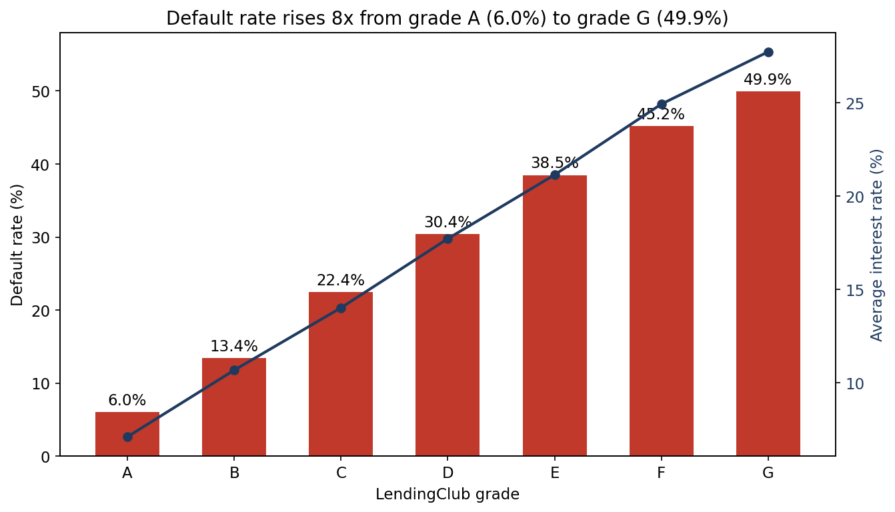

# Loan Default Risk Analysis

**One-line pitch:** Which LendingClub loan applications should a lender approve — and at what grade, rate, amount and term — before the money goes out the door?

**Business question:** A lender funding personal loans has to decide, for each application, whether to approve it and at what grade, interest rate, amount and term. Approve a loan that defaults and most of the principal is lost; decline a loan that would have repaid and the interest income is lost. Which borrower, loan and purpose characteristics actually predict default — and where should lending criteria tighten?



## Key findings

- **Grade works — and the pricing matches it.** Default rates rise monotonically from **6.0% (grade A) to 49.9% (grade G)**, an 8x spread, while the average interest rate rises from 7.1% to 27.7%. The lender's own risk ranking is sound; the decision is where to draw the line, not whether the ranking is right. Even at the finest level, sub-grades are ordered: A1 defaults at 3.2%, G5 at 53.6%.
- **Term is as dangerous as grade.** 60-month loans default at **32.5% vs 16.0% for 36-month loans**, and the gap holds inside every grade (grade C: 27.5% vs 20.5%; grade E: 42.1% vs 32.7%). In a logistic model using only application-time features, term is the single strongest risk driver (odds ratio 1.45 per SD).
- **FICO and debt burden compound.** Borrowers with FICO 650–699 and DTI above 30 default at **33.1%**; borrowers with FICO 800+ and DTI 10–15 default at **5.3%**. The low-FICO + high-DTI segment (FICO &lt;670 and DTI ≥20: 92,392 loans) defaults at 32.0% vs 19.1% for everyone else. Income helps too: under $25k defaults at 24.6%, over $150k at 14.9%.
- **The losses concentrate in the middle of the book, not the tail.** Grades D–G are only 25% of loans but 43% of defaults — yet grade C alone accounts for **$883M of the $3.0B net principal lost**, more than grades E, F and G combined, because C is a large book (28% of loans) at a 22.4% default rate. Debt consolidation is 58% of all loans and 61% of all defaults; small-business loans default most of any purpose (29.7%).

Overall, of **2,260,668 funded loans (2007–2018)**, **1,345,350 have a known outcome**: **19.96% defaulted** (268,599 charged off or in default). **$19.40B** was funded to resolved loans, **$4.18B** of it to loans that defaulted, and after principal recovered the lender lost **$3.00B of principal**. The other 915,318 loans were still Current, Late or In Grace Period and are excluded from every default rate in this repo.

## Data source and size

- **Source:** LendingClub accepted loans, Kaggle dataset "Lending Club Loans Data" (`wordsforthewise/lending-club`), file `accepted_2007_to_2018Q4.csv.gz`, downloaded 2026-11-19. LendingClub became Happen Bank in June 2026; the data are historical LendingClub loans.
- **Size:** 2,260,668 loans after dropping 33 embedded summary-footer rows; 151 columns in the raw file, 23 loaded. 1,345,350 resolved outcomes; 915,318 transitory.
- **Coverage:** issue dates 2007–2018 (through Q4 2018). Grades A–G, 14 purposes, 50 states + DC.

## Tools used

- **DuckDB** — loading, cleaning, and all analysis (SQL with CTEs, window functions, filtered aggregates)
- **SQL** — 17 queries across `sql/02_metrics.sql` … `sql/07_concentration.sql`
- **Python (pandas, matplotlib, seaborn, scikit-learn)** — EDA notebook, charts, stretch default-prediction model
- **HTML** — static dashboard (`dashboard/index.html`); spec for a Power BI / Tableau build in `dashboard/DASHBOARD_SPEC.md`

## Approach

1. **Load** the 1.1 GB CSV into DuckDB (`sql/01_load.sql`, run via `python3 load.py`). Raw files are git-ignored; the database rebuilds from the script.
2. **Clean** — default is defined as Charged Off / Default vs Fully Paid only; transitory loans are excluded from default-rate denominators. Embedded summary-footer rows are dropped, `int_rate`/`term`/`emp_length`/`issue_d` are parsed, FICO is the mean of its range. Every decision is documented in `notes/cleaning_notes.md`, with QA checks in `load.py`.
3. **Define metrics** — default rate on resolved loans, funded $ to defaulted loans, net principal lost (funded $ minus principal recovered).
4. **Analyze in SQL** — 7 questions: headline KPIs and the by-year trend, default by grade/sub-grade/rate band, by purpose, by FICO/income/DTI/employment/home ownership/verification, by amount/term/state, and where the losses concentrate.
5. **Visualize** — default rate by grade, FICO × DTI heatmap, default by purpose and by year, term effect within grade, net loss by grade (`notebooks/01_eda.ipynb`, charts in `images/`).
6. **Stretch model** — logistic regression predicting default from application-time features only (FICO, DTI, income, employment length, loan amount, term, home ownership, purpose, verification). Grade and interest rate are excluded — they are the lender's own post-application assessment, so a granting model cannot use them — and post-origination fields would leak the outcome. ROC-AUC **0.690**: application-time data separates risk only moderately, which is itself the finding — the grade (the lender's judgement) carries information the raw application fields do not.

## Recommendations

- **Cap 60-month terms for grades D–G** (or price them materially higher): 60-month D–G loans default at 36–50%, vs 27–38% on 36-month terms in the same grades.
- **Decline or re-price FICO &lt;670 with DTI ≥20**: 92,392 loans defaulting at 32.0% vs 19.1% for the rest of the book.
- **Tighten small-business purpose**: 29.7% default on 15,416 loans — the worst purpose by a clear margin. Require stronger FICO/DTI or a lower amount cap.
- **Focus on grade C, not just F–G**: C drives the largest dollar loss ($883M net) despite a mid-range default rate; small criteria changes there move the total more than cutting the tiny G book.
- **Fix the unknown-employment-length bucket**: 78,516 loans with no employment length default at 26.9%, the highest of any employment band — collect the field or treat missing as high-risk.
- **Do not use "Verified" as a safety signal**: verified borrowers default at 23.9% vs 14.7% for not-verified, because verification is requested more often on riskier applications. It marks selection, not safety.

## Repository structure

```
loan-default-risk-analysis/
├── README.md
├── load.py                # builds data/loans.duckdb from the CSV + QA checks
├── run_analysis.py        # runs sql/02–07, saves dashboard/*.csv
├── .gitignore
├── data/
│   ├── raw/               # accepted_2007_to_2018Q4.csv.gz (git-ignored, 393 MB)
│   └── loans.duckdb       # built database (git-ignored)
├── sql/
│   ├── 01_load.sql        # raw load + cleaned loans table + bands
│   ├── 02_metrics.sql     # headline KPIs, status mix, default by year
│   ├── 03_grade.sql       # default by grade / sub-grade / rate band / grade x term
│   ├── 04_purpose.sql     # default by purpose, purpose x grade
│   ├── 05_borrower.sql    # FICO, income, DTI, FICO x DTI, employment, ownership, verification
│   ├── 06_terms.sql       # amount, term, state, pricing check
│   └── 07_concentration.sql  # where defaults and losses concentrate
├── notebooks/
│   ├── 01_eda.ipynb       # EDA with embedded charts
│   ├── build_notebook.py  # regenerates the notebook + charts + model
│   └── model_results.txt  # logistic regression ROC-AUC + odds ratios
├── dashboard/
│   ├── index.html         # static dashboard (open in a browser)
│   ├── DASHBOARD_SPEC.md  # Power BI / Tableau build spec
│   └── *.csv              # query outputs backing the dashboard
├── images/                # charts (grade, FICO x DTI, purpose, year, term, loss)
└── notes/
    └── cleaning_notes.md  # every cleaning decision + QA results
```

## How to reproduce

```bash
git clone https://github.com/Saikrishna-469/loan-default-risk-analysis.git
cd loan-default-risk-analysis
pip install duckdb pandas matplotlib seaborn scikit-learn nbformat

# 1. Download the data (Kaggle "Lending Club Loans Data", ~1.36 GB zip)
mkdir -p data/raw
cd data/raw
curl -L -o kaggle_lc.zip "https://www.kaggle.com/api/v1/datasets/download/wordsforthewise/lending-club"
unzip -o kaggle_lc.zip accepted_2007_to_2018Q4.csv.gz
cd ../..

# 2. Load into DuckDB (builds data/loans.duckdb, runs QA checks)
python3 load.py

# 3. Run the analysis (prints results, saves dashboard/*.csv)
python3 run_analysis.py

# 4. Rebuild the notebook, charts and model
python3 notebooks/build_notebook.py

# 5. Open the dashboard
open dashboard/index.html
```

## Limitations

- **Resolved loans only.** Default rates exclude the 915,318 loans still Current, Late or In Grace Period. Recent vintages (2017–2018) are under-represented, and their apparent dip in default rate is partly censoring, not improvement.
- **Funded loans only.** Rejected applications are a separate file and are not analysed here, so nothing in this repo describes the applicant pool — only the book that was funded. FICO in the data starts at ~660 (only 2 resolved loans below 650): the lender's minimum-score floor is visible in the data itself.
- **2007–2018, pre-COVID and pre-Happen Bank.** Lending standards, the economy and the company have all changed since; the patterns are structural (grade, term, FICO × DTI), but the levels are historical.
- **"Verified defaults more" is selection, not causation.** Verification is requested more often on riskier applications; do not read the 23.9% vs 14.7% gap as verification causing defaults.
- **Net principal lost is principal only.** It excludes interest foregone, servicing and collection costs, and recoveries after charge-off beyond what is recorded in the file — it is a lower bound on the true cost of a default.
- **The stretch model is illustrative.** Application-time features predict default only moderately (ROC-AUC 0.690); the grade — the lender's judgement — carries information the raw fields do not. The model is included to show that, not as a production scorecard.
